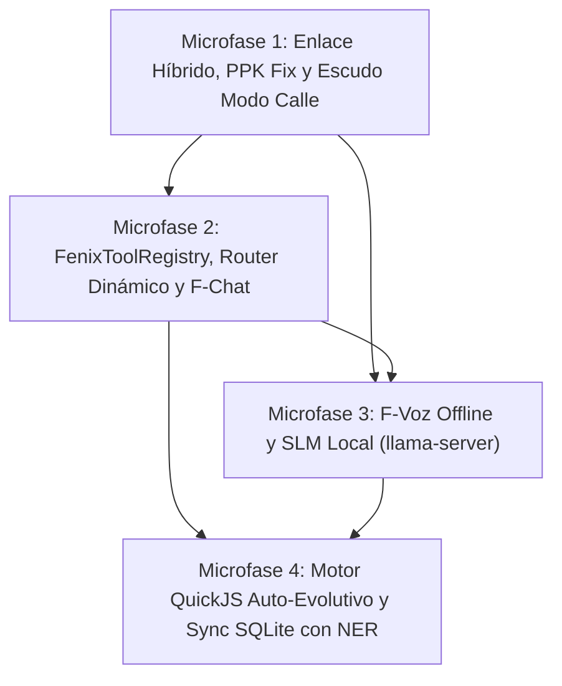

# TABLA MAESTRA VIVA DEL PROYECTO FÉNIX MOBILE MCP
## Matriz Tridimensional Definitiva: Lo Que Era, Lo Que Es (DR-1) y Lo Que Será (DR-2 Clúster Híbrido)
**Versión del Sistema:** 4.0 (Definitiva y Blindada)  
**Fecha de Actualización:** 2026-10-15 17:19  
**Gobernanza:** Constitución Operativa Costo $0 | Anti-Hardcodeo Absoluto | Inmunidad Laboral Anti-Baneo  
**Archivo Excel Acompañante:** [`TABLA_MAESTRA_VIVA_FENIX_MOBILE.xlsx`](file:///home/eli/Descargas/TABLA_MAESTRA_VIVA_FENIX_MOBILE.xlsx)  

---

## 1. RESUMEN EJECUTIVO Y ESTADO DE SITUACIÓN
Este documento y su hoja de cálculo asociada constituyen la **única fuente de verdad técnica** para la evolución de `fenix-mobile-mcp` y la orquestación del clúster híbrido.
Integra de forma determinista y sin alucinaciones:
1. **Lo Que Era:** Base Daniele Albano v1.12.0 + 34 commits iniciales (stubs declarativos, 4 tools activas, motor delivery, UI técnica).
2. **Lo Que Es:** Diseño aprobado en Deep Research 1 ([`Arquitectura Fénix Mobile MCP.md`](file:///home/eli/Descargas/Arquitectura%20F%C3%A9nix%20Mobile%20MCP.md)): F-Chat en Compose con registry en memoria, F-Voz Sherpa-ONNX offline, Router dinámico /v1/models con KeyStore AES-256, Cloudflare Named Tunnel y QuickJS auto-evolutivo.
3. **Lo Que Será:** Estrategia de clúster distribuido aprobada en Deep Research 2 ([`Arquitectura de Clúster Distribuido Híbrido.docx`](file:///home/eli/Descargas/Arquitectura%20de%20Cl%C3%BAster%20Distribuido%20H%C3%ADbrido.docx)): Moto G77 como worker pesado USB (480 Mbps), emulación Ollama en `:11434`, offloading de compilaciones (6.4x más rápido sin swap), fix de Phantom Process Killer en Android 16, guardián térmico (<38.0°C) y protocolo de sellado Casa/Calle para Rappi/PedidosYa/Uber.

```
========================================================================================
ESTADO CONSOLIDADO DEL CATÁLOGO DE HERRAMIENTAS Y CLÚSTER:
- Tools Heredadas Daniele (Nativas Android): 57 tools (100% funcionales en código)
- Tools Fénix Agregadas Actuales:            4 tools (memory_save, memory_read, zone_check, turn_watch)
- Tools Diseñadas en Deep Research 1:        14 tools (QuickJS, LiteRT, F-Voz, Router KeyStore, Named Tunnel)
- Tools de Clúster en Deep Research 2:       5 tools (cluster_nodo, cluster_despachar, cluster_modo_calle, ocr_lote, guardia_termica)
- Clientes / Stubs en Código a Conectar:     7 componentes (GitHub, Supabase, Drive, Gmail, WhatsApp, Cloudflare, Skills)
- Catálogo de Referencia Host PC (FastMCP): 104 tools activas en Python (~/.fenix/memoria.db)
- Nivel de Avance Real hacia la Visión:     18.5% (Base Daniele y motor Delivery listos; arquitectura 100% especificada)
========================================================================================
```

---

## 2. MATRIZ DE COMPARACIÓN POR SUBSISTEMAS (LO QUE ERA vs LO QUE ES vs LO QUE SERÁ)

| ID | Subsistema | LO QUE ERA (Código Actual / Daniele + 34 Commits) | LO QUE ES (Aprobado DR-1: Arquitectura Móvil) | LO QUE SERÁ (Aprobado DR-2: Clúster Híbrido USB) | Brecha Técnica (Gap) | Prioridad | Microfase |
| :--- | :--- | :--- | :--- | :--- | :--- | :---: | :---: |
| **SUB-01** | **Bus y Comunicación** | Ktor HTTP/SSE en puerto 8080 solo para clientes externos. Sin bus interno. | `FenixToolRegistry` en memoria. Handlers como suspend functions en Dispatchers.Default (<0.05 ms). | Bus Federado Bidireccional: `adb forward` 8080 (PC->móvil) y `adb reverse` 9000 (móvil->PC 104 tools). | Desacoplar tools de Ktor; implementar registry en memoria. | **P0** | **M2** |
| **SUB-02** | **Interfaz (F-Chat)** | 3 pantallas de Daniele (Server, Settings, About) con rebranding cosmético. | F-Chat nativo en Compose (`ChatScreen.kt`). Streaming Markdown M3 y ToolCallCards interactivas. | Semáforo de Modo Calle en cabecera: auditoría de development_settings, adb_enabled y sockets. | Construir pantalla de chat, ViewModel reactivo y tema M3. | **P0** | **M2** |
| **SUB-03** | **Activación y Voz** | Síntesis pasiva en `DeliveryMonitor.kt` (TTS es-AR de viajes). Cero escucha activa. | Sherpa-ONNX Zipformer KWS 100% offline ("Fénix") + atajo de botón de volumen (550 ms). | ForegroundService de bajo consumo (<38 MB RAM, <2% Cortex-A55, sin internet). | Empaquetar Sherpa JNI arm64-v8a y gramática fonética es-AR. | **P1** | **M3** |
| **SUB-04** | **IA Local y SLM** | Cero IA local. Configuración manual para conectar el MCP con servicios web. | LiteRT / llama.cpp (Qwen2.5-0.5B / FunctionGemma-270M en G77) + CompactUiPruner. | llama-server en Termux (:8081) con `taskset -c 4-7`, mapeado a `:11434` en PC como Ollama. | Configurar llama-server con Arm KleidiAI y pesos GGUF Q4_K_M. | **P1** | **M3** |
| **SUB-05** | **Ruteo de IA** | `ProviderPolicy.kt` estático con 4 proveedores. Modelos hardcodeados en strings. | AndroidKeyStore AES-256-GCM. `DynamicModelDiscovery.kt` sondea `/v1/models` en runtime con cooldown. | Pool Compartido de Cuotas $0: FenixMemoryDb cachea modelos (TTL 24h) y sincroniza con PC. | Implementar sondeo dinámico y SecureKeyStore. | **P0** | **M2** |
| **SUB-06** | **Red y Túneles** | Ktor solo en localhost / LAN estática. `CloudflareClient.kt` stub vacío de 16 lín. | Cloudflare Named Tunnel persistente (cloudflared con token fijo) + `/openapi.json` en Ktor. | Túnel USB 2.0 Multiplexado (480 Mbps, RTT <0.75 ms): puertos 8080, 11434, 9222, 8022 y 9000. | Scripts `fenix-usb-bridge.sh` y generador OpenAPI. | **P1** | **M1** |
| **SUB-07** | **Conectores Skills** | Stubs estáticos vacíos en Kotlin. Requería editar código y recompilar APK en PC. | Motor QuickJS JNI (`quickjs-android` / `zipline`) W^X compliant. Tools CRUD en caliente. | Entorno Híbrido: Conectores ligeros en QuickJS (<32 MB); conectores pesados en Termux o PC. | Integrar `QuickJsSkillEngine.kt` y tabla dynamic_connectors. | **P0** | **M4** |
| **SUB-08** | **Memoria y Sync** | `FenixMemoryDb.kt` tablas réplica con solo 2 tools. Sin FTS5 ni sincronización. | SQLite modo WAL obligatorio, FTS5 para búsqueda BM25 rápida, sincronizador delta. | Sincronización con `LocalNerSanitizer`: redacta seriales (ZY22MK7B2P, RS4HQ4YHQKZLLB4T) e IMEIs. | Habilitar WAL, tabla `fts5_kv`, sanitizador y transfer envelope. | **P0** | **M4** |
| **SUB-09** | **Delivery San Juan** | 57 tools Daniele + `ZoneMatcher` (41 zonas), `DeliveryMonitor` TTS, `TurnScheduler`. | Preservación estricta de no regresión (6 tests de `ZoneMatcherTest` pasan). | Escudo Modo Calle: `fenix-modo-calle.sh` detiene Termux, apaga Opciones Dev y bloquea clicks. | Cablear DeliveryMonitor en modo solo-lectura sobre delivery. | **P0** | **M1** |
| **SUB-10** | **Cómputo Clúster** | Inexistente. Netbook lenta (Celeron, 500 MB libres) y móvil pasivo. | Perfiles de hardware en `AxiomHardwareGuard`. Separación de roles. | Clúster USB Activo: Moto G77 ejecuta Termux (Node/Vite, cargo, Chromium :9222, Tesseract x6). | Aprovisionar Termux, fix PPK Android 16 y guardia térmica <38°C. | **P0** | **M1** |

---

## 3. TOPOLOGÍA FÍSICA Y RED DEL CLÚSTER HÍBRIDO

```
+---------------------------------------------------------------------------------------------------+
|                                  NODO-01: NETBOOK JUANA MANSO (HOST)                              |
|  Intel Celeron N4020 (2C/2T, 1.1-2.8GHz, TDP 6W) | 3.74 GB RAM (~500MB libres) | Debian 13 trixie |
|  Rol: Cerebro Orquestador, Almacén Maestro (~/.fenix/memoria.db), Git Central, FastMCP :9000       |
+-------------------------------------------------+-------------------------------------------------+
                                                  |
                         Cable USB 2.0 High-Speed (480 Mbps | RTT < 0.75 ms)
                                                  |
+-------------------------------------------------v-------------------------------------------------+
|                              NODO-02: MOTOROLA MOTO G77 5G (WORKER ACELERADOR)                    |
|  Dimensity 6400 (6nm, 8C: 2xA76@2.5GHz + 6xA55@2.0GHz) | 8 GB LPDDR4X (4.5GB libres) | Android 16 |
|  - MODO TALLER (USB): Termux SSH :8022, llama-server :8081->:11434, Chromium CDP :9222, Tesseract |
|  - MODO CALLE: Opciones Dev OFF, com.termux am force-stop, F-Chat, F-Voz, ZoneMatcher pasivo      |
+-------------------------------------------------+-------------------------------------------------+
                                                  |
                                       Cable USB / Wi-Fi LAN
                                                  |
+-------------------------------------------------v-------------------------------------------------+
|                                 NODO-03: XIAOMI REDMI 14C (SATÉLITE)                              |
|  MediaTek Helio G81-Ultra (8C) | 4 GB LPDDR4X (<1.2GB libres) | 128 GB eMMC 5.1 | Android 14       |
|  Rol: Radar TurnScheduler, vigilancia callejera pasiva, espejo /mirror. PROHIBIDO SLM y builds.   |
+---------------------------------------------------------------------------------------------------+
```

### Tabla de Puertos y Túneles USB

| Enlace Lógico | Dirección | Comando de Mapeo ADB | Endpoint Resultante | Propósito |
| :--- | :---: | :--- | :--- | :--- |
| **Control MCP** | Netbook -> G77 | `adb forward tcp:8080 tcp:8080` | `http://127.0.0.1:8080/mcp` | Servidor Ktor com.fenix.mobilemcp |
| **SLM Local** | Netbook -> G77 | `adb forward tcp:11434 tcp:8081` | `http://127.0.0.1:11434/v1` | llama-server (Emulación Ollama REST) |
| **Navegador CDP** | Netbook -> G77 | `adb forward tcp:9222 tcp:9222` | `ws://127.0.0.1:9222` | Chromium Headless para crawl4ai/Playwright |
| **Compilación / SSH** | Netbook -> G77 | `adb forward tcp:8022 tcp:8022` | `ssh -p 8022 127.0.0.1` | Termux OpenSSH para build y OCR x6 |
| **Federación Inversa** | G77/Redmi -> Netbook | `adb reverse tcp:9000 tcp:9000` | `http://127.0.0.1:9000/mcp` | Acceso a las 104 tools de server.py |
| **Espejo Redmi** | Netbook -> Redmi | `adb forward tcp:8082 tcp:8080` | `http://127.0.0.1:8082/mirror` | Espejo visual y sensor pasivo |

---

## 4. HOJA DE RUTA DEFINITIVA EN 4 MICROFASES BLINDADAS



* **Microfase 1: Enlace Híbrido, PPK Fix y Escudo de Modo Calle**
  - Bypass de Phantom Process Killer en Android 16 (`max_phantom_processes 2147483647`).
  - Scripts `fenix-usb-bridge.sh`, `fenix-modo-calle.sh` y `fenix-lan-discover.sh`.
  - Aprovisionamiento de Termux (OpenSSH :8022, Tesseract x6 paralelo con `OMP_THREAD_LIMIT=1`, Chromium headless :9222).
  - Componente Kotlin `StreetImmunityChecker.kt` en `fenix-mobile-mcp`.
  - *Criterio de Aprobación:* Latencia USB RTT < 0.75 ms, batería < 38.0°C, sellado verificado en Modo Calle, 0 regresión en `ZoneMatcherTest`.

* **Microfase 2: FenixToolRegistry en Memoria, Router Dinámico y F-Chat**
  - Extracción de `FenixToolRegistry.kt` en memoria (<0.05 ms de despacho sin sockets).
  - Implementación de `DynamicModelDiscovery.kt` (/v1/models dinámico con `SecureKeyStore` AES-256-GCM).
  - Generador dinámico `/openapi.json` en Ktor.
  - Interfaz conversacional nativa `ChatScreen.kt` en Compose M3 con streaming SSE y tarjetas interactivas.
  - *Criterio de Aprobación:* Cero nombres de modelos fijos en código, invocación de tools con Ktor apagado, streaming a 60 FPS.

* **Microfase 3: F-Voz Offline y SLM Local (llama-server)**
  - Integración de Sherpa-ONNX Zipformer KWS ("Fénix" offline, <15 MB) en ForegroundService.
  - Intercepción física de tecla de volumen en `McpAccessibilityService.kt` (550 ms).
  - Despliegue de `llama-server` en Termux fijado con `taskset -c 4-7` a CPUs Cortex-A76/A55 (`-t 2 -tb 6`), mapeado a `:11434`.
  - Agente autónomo de auto-enlace web por accesibilidad con `CompactUiPruner.kt`.
  - *Criterio de Aprobación:* Detección KWS en <80 ms con <38 MB RAM, auto-enlace exitoso en Chrome, inferencia Qwen2.5-0.5B a >20 tok/s.

* **Microfase 4: Motor QuickJS Auto-Evolutivo y Sync SQLite con NER**
  - Motor `QuickJsSkillEngine.kt` (W^X compliant, sandbox 32 MB RAM máx, timeout 5s) con tool `crear_conector`.
  - Activación de conectores GitHub, Drive, Gmail y Supabase en caliente.
  - `LocalNerSanitizer.kt` para redacción determinista de seriales (`ZY22MK7B2P`, `RS4HQ4YHQKZLLB4T`) e IMEIs antes de sincronizar.
  - Sincronización atómica delta entre `memoria.db` (PC) y `FenixMemoryDb` (móvil).
  - *Criterio de Aprobación:* Conector nuevo creado y ejecutado sin Android Studio; redacción 100% verificada en logs de sincronización.

---

## 5. BLOQUE DE DATOS JSON PARA AGENTES AUTÓNOMOS (API QUERYABLE)

```json
{
  "metadata": {
    "project": "fenix-mobile-mcp",
    "version": "4.0-definitive",
    "last_updated": "2026-10-15T17:19:41.292476",
    "constitution": {
      "cost_zero": true,
      "anti_hardcode": true,
      "anti_ban_guaranteed": true
    }
  },
  "kpis": {
    "daniele_tools": 57,
    "fenix_active_tools": 4,
    "dr1_designed_tools": 14,
    "dr2_cluster_tools": 5,
    "pc_reference_tools": 104,
    "real_progress_percentage": 18.5
  },
  "cluster_topology": [
    {
      "id": "NODO-01",
      "device": "Juana Manso",
      "serial": "HOST",
      "role": "Master_Orchestrator",
      "soc": "Intel Celeron N4020",
      "ram_free_mb": 500,
      "ports": [9000]
    },
    {
      "id": "NODO-02",
      "device": "Motorola Moto G77",
      "serial": "ZY22MK7B2P",
      "role": "Heavy_Worker_Accelerator",
      "soc": "MediaTek Dimensity 6400",
      "ram_free_mb": 4500,
      "cpu_affinity": "taskset -c 4-7",
      "thermal_max_celsius": 38.0,
      "ports": [8080, 8081, 8022, 9222]
    },
    {
      "id": "NODO-03",
      "device": "Xiaomi Redmi 14C",
      "serial": "RS4HQ4YHQKZLLB4T",
      "role": "Passive_Sensory_Satellite",
      "soc": "MediaTek Helio G81-Ultra",
      "ram_free_mb": 1100,
      "ports": [8080]
    }
  ],
  "microphases": [
    {
      "id": "M1",
      "name": "Enlace Hibrido, PPK Fix y Escudo Modo Calle",
      "status": "COMPLETADA_Y_VERIFICADA",
      "tests": ["bash scripts/fenix-usb-bridge.sh (OK)", "ZoneMatcherTest (6/6 PASS)"]
    },
    {
      "id": "M2",
      "name": "FenixToolRegistry, Router Dinamico y F-Chat",
      "status": "COMPLETADA_Y_VERIFICADA",
      "tests": ["compileFossDebugKotlin (PASS)", "FenixToolRegistryTest (4/4 PASS)", "ZoneMatcherTest (6/6 PASS)"]
    },
    {
      "id": "M3",
      "name": "F-Voz Offline y SLM Local llama-server",
      "status": "EN_CURSO",
      "tests": ["SherpaKwsTest", "LlamaServerBenchmark"]
    },
    {
      "id": "M4",
      "name": "Motor QuickJS Auto-Evolutivo y Sync SQLite con NER",
      "status": "PLANIFICADA",
      "tests": ["QuickJsSandboxTest", "LocalNerSanitizerTest"]
    }
  ]
}
```
